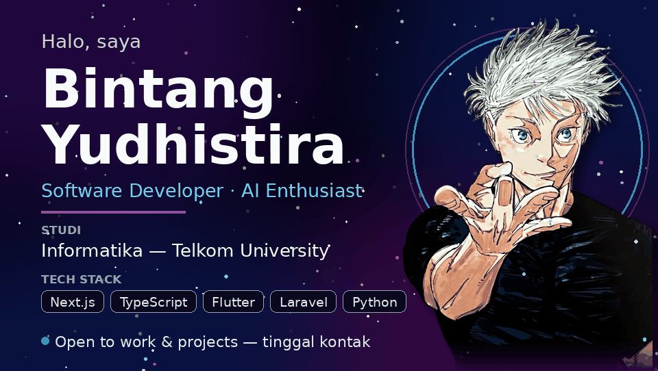
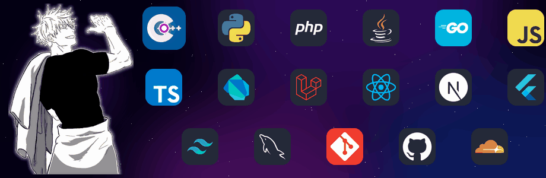
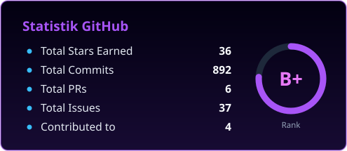
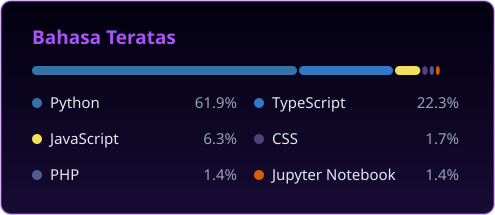

  

  

  

<!-- GIF ngetik disembunyikan dulu: ga nyambung sama tema (2026-10-24)

  

-->

  

---

## Tentang Saya

  

Halo, saya Bintang. Mahasiswa Informatika di Telkom University.

Saya suka bikin website, aplikasi, dan model machine learning, terutama computer vision. Sehari-hari pakai Laravel, Next.js, dan Flutter, dengan Supabase/MySQL di sisi database. Deploy di Vercel, Netlify, atau cPanel, dan lagi belajar ngurus VPS.

Saya juga sering bikin chatbot (Telegram, Discord, dll) dan tools kecil buat mempermudah kerjaan orang.

Pengalaman kerja: Junior Software Engineer di PT KRISNA ARDHI TAMA (implementasi ERP, Januari sampai Juni 2026) dan magang di divisi Perencanaan TI Pengadilan Negeri Purwokerto (2025).

Oktober sampai November 2026 saya menjalankan program portofolio tujuh repo dalam empat minggu, satu repo selesai tiap minggu, dan sekarang lanjut membangun Gaiden ERP berbasis Laravel. Rinciannya ada di bagian Proyek Unggulan di bawah.

Portfolio: [bintangyudhis.my.id](https://bintangyudhis.my.id)

<b>Read in English: About Me</b>

Hi, I'm Bintang. An Informatics student at Telkom University.

I like building websites, apps, and machine learning models, especially computer vision. Day to day I work with Laravel, Next.js, and Flutter, with Supabase/MySQL on the database side. I deploy to Vercel, Netlify, or cPanel, and I am learning to manage a VPS.

I also build chatbots (Telegram, Discord, and others) and small tools that make other people's work easier.

Work experience: Junior Software Engineer at PT KRISNA ARDHI TAMA (ERP implementation, January to June 2026) and an intern in the IT Planning division of the Purwokerto District Court (2025).

From October to November 2026 I ran a portfolio program of seven repos in four weeks, one repo finished each week, and I am now continuing with Gaiden ERP, a Laravel-based ERP. The details are in the Featured Projects section below.

Portfolio: [bintangyudhis.my.id](https://bintangyudhis.my.id)

---

  

## Teknologi & Tools

  

---

## Proyek Unggulan

Proyek-proyek di bawah ini dibangun berurutan dalam program portofolio Oktober sampai November 2026, satu repo selesai tiap minggu.

- **[DompetKu](https://github.com/bintangyudhis/dompetku-web)**: web pencatat keuangan pribadi. Pemasukan dan pengeluaran, kategori, budget, pemasukan rutin, impor dan ekspor CSV, plus API untuk aplikasi Android di bawah. Live: [dompetku.bintangyudhis.my.id](https://dompetku.bintangyudhis.my.id)
- **[DompetKu App](https://github.com/bintangyudhis/dompetku-app)**: aplikasi Flutter untuk DompetKu. Login email dan kata sandi yang sama dengan versi web, datanya tersimpan di database yang sama.
- **[Pendekin](https://github.com/bintangyudhis/pendekin)**: pemendek tautan dengan akun pengguna. Slug bisa dibuat sendiri, tiap tautan punya statistik klik, dan dashboard hanya menampilkan tautan milik akun yang masuk. Live: [pendekin.bintangyudhis.my.id](https://pendekin.bintangyudhis.my.id)
- **[Animequ](https://github.com/bintangyudhis/animequ)**: katalog anime dari API AniList. Jadwal rilis, peringkat, jelajah per genre, dan di halaman detail ada video Muse Indonesia yang sudah diverifikasi cocok dengan judulnya. Live: [anime.bintangyudhis.my.id](https://anime.bintangyudhis.my.id)
- **[Tulisqu](https://github.com/bintangyudhis/tulisqu)**: tempat menyimpan catatan kuliah per mata kuliah, upload berkas, simpan tautan, dan daftar tugas harian. Live: [tulis.bintangyudhis.my.id](https://tulis.bintangyudhis.my.id)
- **[Topi Surya IoT](https://github.com/bintangyudhis/topi-surya-iot)**: dashboard untuk kipas topi bertenaga panel surya. Telemetri dari ESP32, kontrol kipas, halaman riwayat, dan simulator kalau perangkat aslinya tidak terhubung.

Daftar lengkap proyek ada di [bintangyudhis.my.id/proyek](https://www.bintangyudhis.my.id/proyek).

<b>Read in English: Featured Projects</b>

The projects below were built one after another in a portfolio program from October to November 2026, one repo finished each week.

- **[DompetKu](https://github.com/bintangyudhis/dompetku-web)**: a personal finance tracker web app. Income and expenses, categories, budgets, recurring income, CSV import and export, plus an API for the Android app below. Live: [dompetku.bintangyudhis.my.id](https://dompetku.bintangyudhis.my.id)
- **[DompetKu App](https://github.com/bintangyudhis/dompetku-app)**: the Flutter app for DompetKu. Same email and password login as the web version, with data stored in the same database.
- **[Pendekin](https://github.com/bintangyudhis/pendekin)**: a link shortener with user accounts. Custom slugs, click statistics for every link, and a dashboard that only shows the signed-in account's links. Live: [pendekin.bintangyudhis.my.id](https://pendekin.bintangyudhis.my.id)
- **[Animequ](https://github.com/bintangyudhis/animequ)**: an anime catalogue powered by the AniList API. Release schedules, rankings, browsing by genre, and detail pages with Muse Indonesia videos verified to match the title. Live: [anime.bintangyudhis.my.id](https://anime.bintangyudhis.my.id)
- **[Tulisqu](https://github.com/bintangyudhis/tulisqu)**: a place to store lecture notes by course, upload files, save links, and keep a daily task list. Live: [tulis.bintangyudhis.my.id](https://tulis.bintangyudhis.my.id)
- **[Topi Surya IoT](https://github.com/bintangyudhis/topi-surya-iot)**: a dashboard for a solar-powered hat fan. ESP32 telemetry, fan control, a history page, and a simulator when the real device is not connected.

The full project list is at [bintangyudhis.my.id/proyek](https://www.bintangyudhis.my.id/proyek).

---

  

## Statistik GitHub

  

  
  

  

---

## Grafik Kontribusi

  

  

---

  

## Kontak

  
  &nbsp;&nbsp;
  
  &nbsp;&nbsp;
  

  Email: bintangyudhistira36@gmail.com

